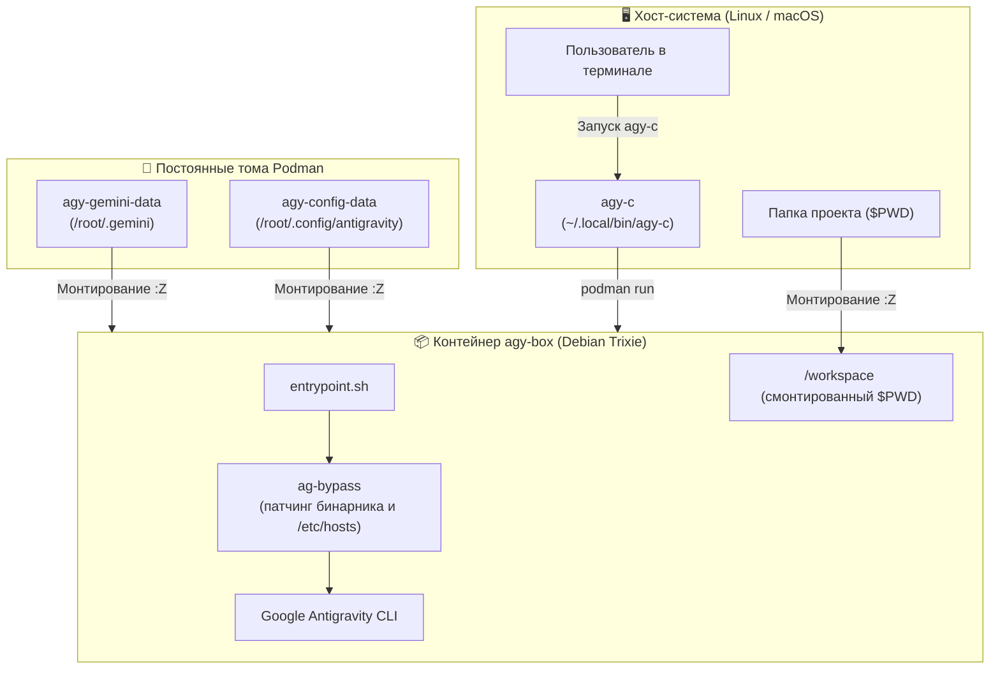

<div align="center">

# 📦 ag-isolate

**Безопасный изолированный запуск Google Antigravity CLI в контейнере Podman**

[](#)
[](#)
[](#)
[](#)

*Дает AI-агенту полную свободу без риска для вашей операционной системы.*

[Особенности](#особенности) •
[Архитектура](#архитектура) •
[Быстрый старт](#быстрый-старт) •
[Использование](#использование) •
[Параметры запуска](#параметры-запуска) •
[Безопасность](#модель-безопасности)

---

</div>

<a id="особенности"></a>
## ✨ Особенности

* 🛡️ **Полная изоляция хоста:** Агент запускается с флагом `--dangerously-skip-permissions` внутри контейнера Podman. Он может выполнять скрипты (Node.js, Python 3), устанавливать пакеты через `apt` и выполнять любые команды, оставаясь изолированным от хост-системы.
* ⚡ **Контроль ресурсов (Quotas):** Жесткие лимиты на оперативную память (**8 ГБ**), ядра процессора (**4 CPU**) и количество процессов (**500 pids**) защищают хост от зависаний, fork-бомб и утечек памяти.
* 🌐 **Встроенный обход сетевых блокировок:** Модуль `ag-bypass` автоматически активируется (`./ag on`) при старте контейнера, выполняя бинарный патч клиента `agy` и настраивая маршрутизацию доменов Google в `/etc/hosts` через SmartDNS/SNI-прокси для стабильной связи из регионов с ограничениями.
* 💾 **Сохранение сессий и авторизации:** Данные авторизации Google Gemini и конфигурация Antigravity сохраняются в постоянных томах Podman (`agy-gemini-data` и `agy-config-data`), поэтому повторно входить в аккаунт при каждом запуске не требуется.
* 🚨 **Защита от запуска в опасных директориях:** Лаунчер проверяет текущий путь по маске `^$HOME/[^./]`. При запуске вне разрешенных поддиректорий домашней папки (из корня системы `/`, самого `~` или скрытых директорий вроде `~/.config`) выводится предупреждение, а действие по умолчанию отменяет запуск (`[y/N]`).

---

<a id="архитектура"></a>
## 🏛️ Архитектура



---

<a id="быстрый-старт"></a>
## 🚀 Быстрый старт

### 1. Клонирование репозитория
Клонируйте репозиторий вместе с сабмодулями:

```bash
git clone --recurse-submodules git@github.com:Ferrddd/ag-isolate.git
cd ag-isolate
```

### 2. Установка
Запустите скрипт установки:

```bash
chmod +x install.sh
./install.sh
```

Инсталлятор автоматически:
1. Инициализирует и обновит сабмодули (`git submodule update --init --recursive`).
2. Проверит наличие `podman` (при отсутствии предложит установить через `apt`, `brew` или `pacman`).
3. На macOS при необходимости создаст (`podman machine init`) и запустит виртуальную машину (`podman machine start`).
4. Соберет контейнерный образ `agy-box` из `Dockerfile`.
5. Скопирует лаунчер `src/agy-c` в `~/.local/bin/agy-c` и сделает его исполняемым.

> [!TIP]
> Убедитесь, что каталог `~/.local/bin` включен в переменную `$PATH` вашей оболочки.

---

<a id="использование"></a>
## 💻 Использование

Перейдите в директорию нужного проекта и выполните:

```bash
agy-c
```

### Как работает запуск:

1. **Проверка рабочей директории:**
   - Если запуск происходит из обычной поддиректории домашней папки (например, `~/projects/my-app`), выводится запрос подтверждения:
     ```
     Запустить Antigravity в /home/user/projects/my-app? [Y/n]
     ```
     (по умолчанию `Y` — достаточно нажать Enter).
   - Если запуск происходит из корня системы (`/`), самого `~` или скрытой директории (`~/.config`), выводится предупреждение:
     ```
     ВНИМАНИЕ: запуск Antigravity в /home/user небезопасен
     Запустить Antigravity в /home/user? [y/N]
     ```
     (по умолчанию `N` — безопасный отказ при нажатии Enter).
   - При ответе `y`/`Y` скрипт выводит `[*] Запуск Antigravity` и стартует контейнер.
   - При ответе `n`/`N` выводится `Запуск отменен` (код завершения `1`).
   - При любом другом вводе выводится `Нераспознанный ввод, запуск отменен` (код завершения `1`).

2. **Запуск агента (по умолчанию):**
   Если аргументы не переданы, скрипт запускает контейнер, в котором `entrypoint.sh` активирует `ag-bypass` и выполняет команду по умолчанию из `Dockerfile`:
   ```bash
   agy --dangerously-skip-permissions
   ```

3. **Переопределение команды контейнера:**
   Любые переданные в `agy-c` аргументы заменяют `CMD` контейнера, выполняясь после активации `ag-bypass`. Например, для входа в командную строку контейнера:
   ```bash
   agy-c bash
   ```
   Или для вызова `agy` с произвольными параметрами:
   ```bash
   agy-c agy --help
   ```

---

<a id="параметры-запуска"></a>
## ⚙️ Параметры запуска

Все параметры зафиксированы в кодовой базе проекта:

* **Флаги запуска `podman run` (в `src/agy-c`):**
  * `--rm` — автоматическое удаление контейнера после завершения работы
  * `-it` — интерактивный режим с выделением TTY
  * `--memory=8g` — ограничение оперативной памяти (8 ГБ RAM)
  * `--cpus=4` — ограничение ресурсов процессора (до 4 ядер)
  * `--pids-limit=500` — лимит количества процессов (защита от fork-бомб)
  * `-v agy-gemini-data:/root/.gemini:Z` — именованный том для токенов авторизации Google Gemini
  * `-v agy-config-data:/root/.config/antigravity:Z` — именованный том для настроек Antigravity
  * `-v "${PWD}:/workspace:Z"` — монтирование текущего каталога проекта в `/workspace` (флаг `:Z` для SELinux)
  * `-w /workspace` — установка рабочей директории внутри контейнера
* **Окружение контейнера (`Dockerfile` и `src/container-config.sh`):**
  * Базовый образ: Debian Trixie (`debian:trixie`)
  * `ENV PATH="/root/.local/bin:${PATH}"`
  * Установленные пакеты: `ca-certificates`, `curl`, `sudo`, `procps`, `git`, `python3`, `nodejs`
  * Предустановленный CLI: `Google Antigravity CLI` (устанавливается через скрипт `https://antigravity.google/cli/install.sh`)
* **Точка входа (`entrypoint.sh`):**
  * Патчит `core/hosts.py` в модуле `ag-bypass` (замена `os.replace` на `shutil.copyfile` для обхода ошибки монтирования `Device or resource busy`)
  * Запускает `./ag on`
  * Переходит в `/workspace` и выполняет переданную команду (`exec "$@"`)

---

<a id="модель-безопасности"></a>
## 🔒 Модель безопасности

> [!WARNING]
> При запуске контейнера в него монтируется ваша **текущая рабочая директория** (`$PWD`). 
> Запуск из корневого каталога (`/`) или домашней папки (`~`) открывает агенту доступ ко всем вашим личным файлам и конфигам хоста. Лаунчер предупредит об этом, но рекомендуется всегда переходить в изолированную папку конкретного проекта перед запуском `agy-c`.

| Компонент | Уровень изоляции | Описание |
| :--- | :---: | :--- |
| **Файловая система** | 🟢 Высокий | Изолирована. Доступна только монтируемая директория проекта (`$PWD` в `/workspace`) и постоянные тома Podman для сессий |
| **Процессы (PID)** | 🟢 Высокий | Ограничение в 500 процессов (`--pids-limit=500`) защищает от fork-бомб |
| **Память и CPU** | 🟢 Высокий | Жесткий лимит `cgroups` (8 ГБ RAM, 4 CPU) |
| **Привилегии хоста** | 🟢 Высокий | В rootless Podman root внутри контейнера отображается на непривилегированного пользователя хоста через user namespaces |
| **Сеть** | 🟡 Стандартный | Сеть контейнера с автоматической активацией `ag-bypass` при старте (патчинг бинарника и маршрутизация доменов Google через `/etc/hosts`) |

---

<div align="center">
Made with ❤️ for safe AI-assisted development
</div>
